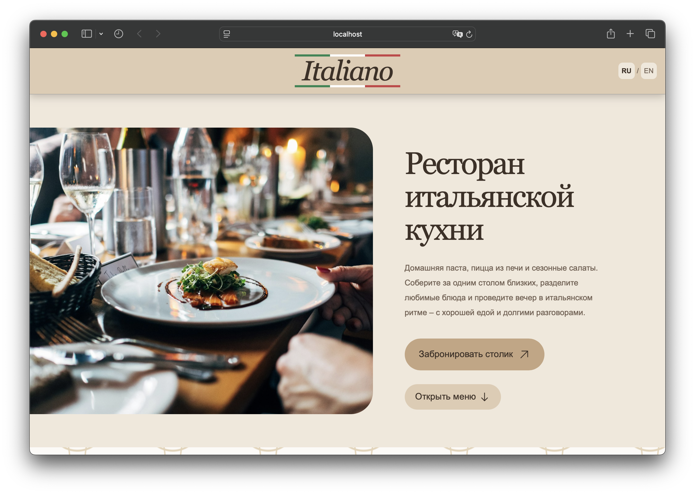
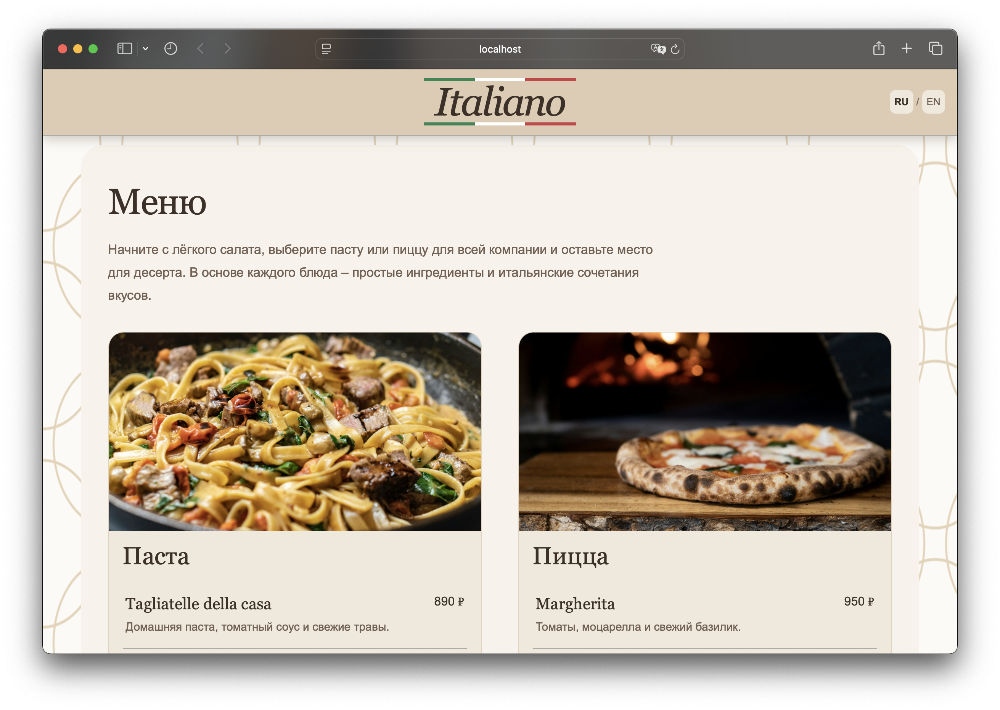
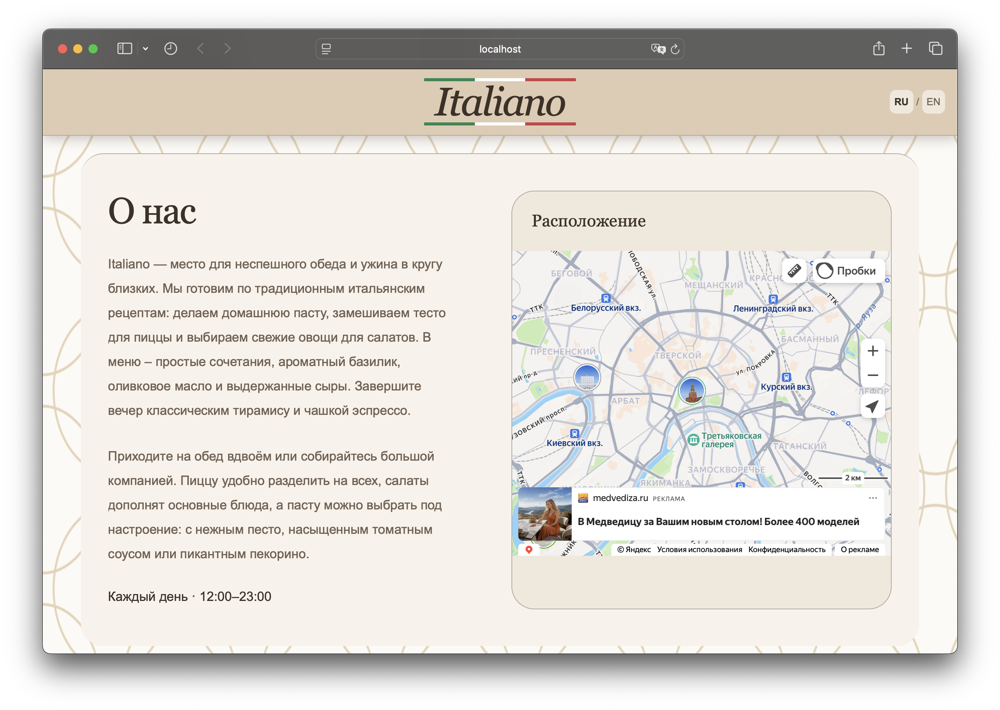
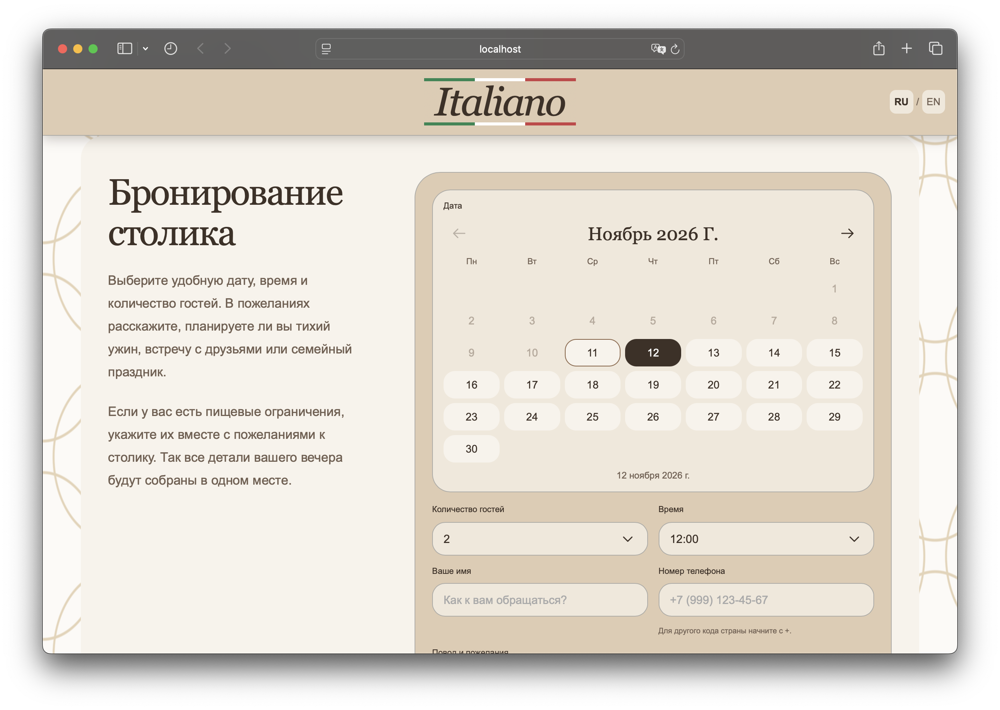

# Italiano - ресторан

Пример лендинга ресторана итальянской кухни: меню, возможность выбора языка.

## Функционал

- Просмотр меню и позиций, возможна автоматизация.
- Форма бронирования столика с выбором даты, времени, количества человек и комментарием.
- Интерактивная Яндекс карта.
- Возможность выбора русского/английского языка.

## Превью сайта

<table>
  <tr>
    <td></td>
    <td></td>
    <td></td>
    <td></td>
  </tr>
</table>
